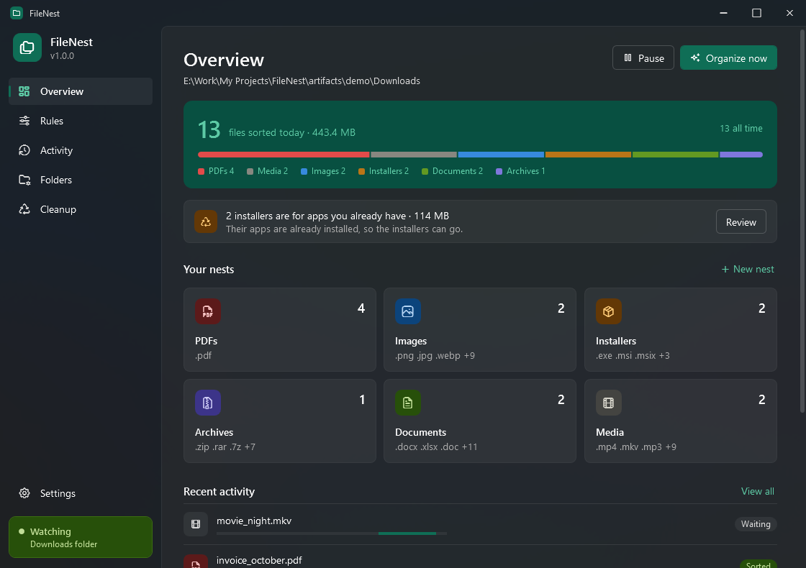
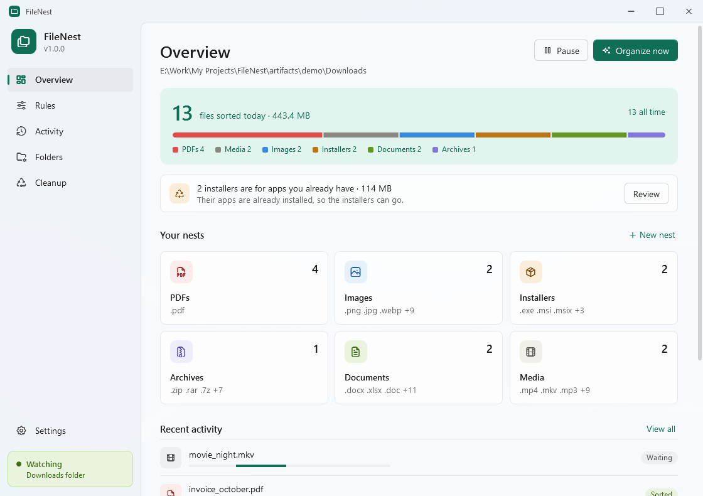
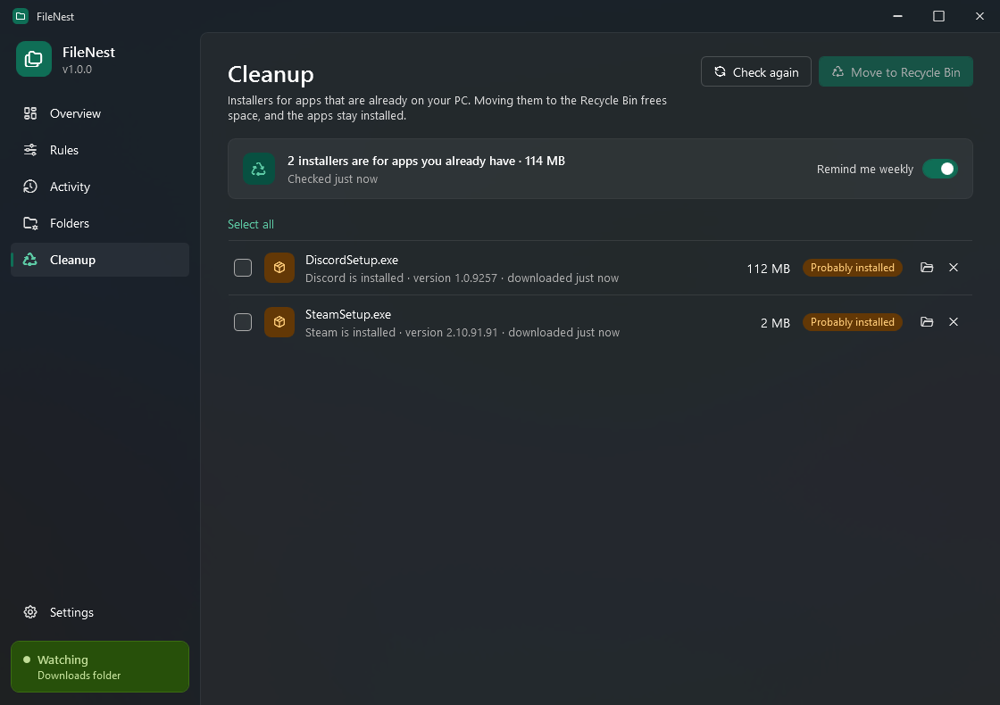
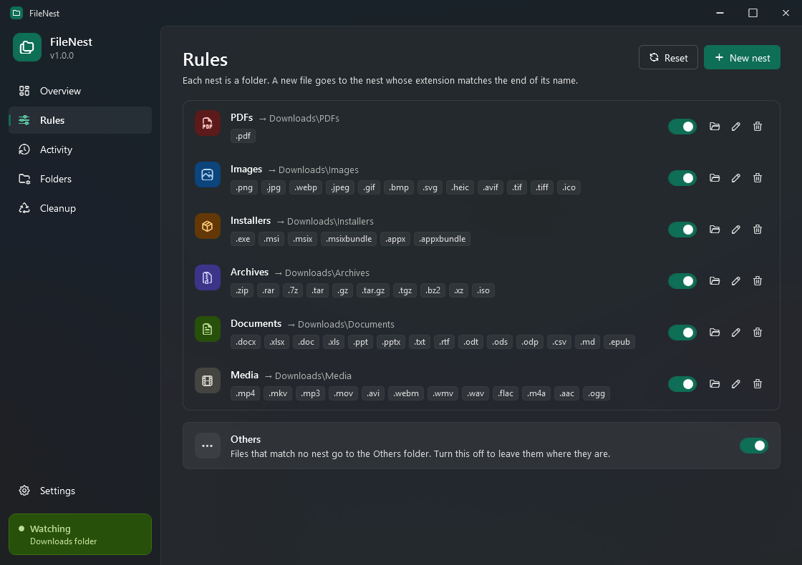
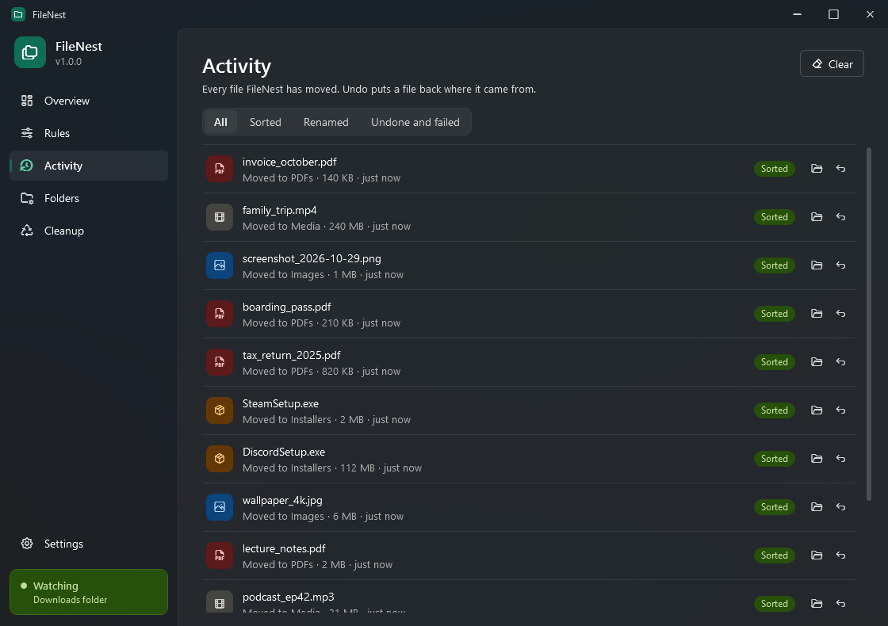

<div align="center">


# FileNest

**Your Downloads folder, tidy on its own.**

FileNest sits in the Windows tray and moves every finished download into a folder for its type:
PDFs, images, installers, archives, documents and media. It also spots installers you no longer need.

[](https://github.com/SarveshP16/FileNest/releases/latest)
[](https://github.com/SarveshP16/FileNest/releases)
[](https://github.com/SarveshP16/FileNest/actions/workflows/ci.yml)


[](https://ko-fi.com/crystaxit)

[**Download FileNest**](https://github.com/SarveshP16/FileNest/releases/latest/download/FileNest-win-Setup.exe) ·
[Website](https://sarveshp16.github.io/FileNest/) ·
[Release notes](https://github.com/SarveshP16/FileNest/releases)



</div>

## Features

**Sorts as you download**
- Moves each new file into its nest: `Downloads\PDFs`, `Downloads\Images`, `Downloads\Installers` and so on
- Waits until the browser has finished, so half-downloaded `.crdownload` and `.part` files are never touched
- Never overwrites: a second `report.pdf` becomes `report (1).pdf`
- Undo any move from the pop-up or from Activity
- **Organize now** tidies everything that's already in the folder (it asks first)

**Cleans up after installs**
- **Cleanup** finds installers for apps that are already on your PC, by checking Windows' installed-apps list
  and the product name inside each `.exe` and `.msi`
- Moves the ones you pick to the Recycle Bin, so nothing is lost for good
- An optional weekly reminder tells you how much space you can free

**Yours to shape**
- Make your own nests with any file extensions, icon and color
- Watch a different folder, or keep nests somewhere else
- Light and dark themes, seven accent colors, and an Explorer-style (Mica) or glass window
- Runs quietly in the tray, can start with Windows, and updates itself

## Screenshots

| | |
|---|---|
|  |  |
| **Overview** in light mode | **Cleanup** finds installers you no longer need |
|  |  |
| **Rules**: every nest and its file types | **Activity**: every move, with Undo |

## Install

1. Download [**FileNest-win-Setup.exe**](https://github.com/SarveshP16/FileNest/releases/latest/download/FileNest-win-Setup.exe).
2. Run it. FileNest installs for your account only (no admin needed) and opens right away.

If your PC doesn't have the .NET 10 Desktop Runtime yet, Setup installs it first.

> **"Windows protected your PC"?** The installer isn't code-signed yet, so SmartScreen warns about it.
> Choose **More info**, then **Run anyway**.

FileNest checks for updates in the background and installs them when it restarts. You can turn that off in
**Settings → Updates**. To remove it, open **Settings → Apps → Installed apps**. Your settings in
`%APPDATA%\FileNest` are kept.

## How it works

FileNest watches the top level of your Downloads folder. When a new file appears, it waits until the file
stops changing, no browser temp file sits next to it, and nothing else has it open. Then it moves the file
into the nest whose extension matches the end of its name; the longest match wins, so `.tar.gz` beats `.gz`.
Files that match no nest go to `Others`, unless you turn that off. Folders and files in subfolders are
never moved.

## Build from source

You need Windows and the [.NET 10 SDK](https://dotnet.microsoft.com/download/dotnet/10.0).

```powershell
dotnet build
dotnet run --project src/FileNest
dotnet test
```

To try it without touching your real settings, point it at a test data folder. Put a `settings.json` there
containing `{"watchFolder": "C:\\some\\test\\folder"}` to watch a test folder instead of Downloads.

```powershell
$env:FILENEST_DATA = "C:\temp\filenest-test"; dotnet run --project src/FileNest
```

### Releasing

```powershell
.\build-installer.ps1 -Version 1.0.1                                  # builds artifacts\installer\FileNest-win-Setup.exe
.\build-installer.ps1 -Version 1.0.1 -ReleaseNotes notes.md -Publish  # also publishes a GitHub release
```

Installers are made with [Velopack](https://velopack.io). `-Publish` fetches the previous release so the
update is a small download, then uploads to GitHub Releases using `GITHUB_TOKEN` or your `gh` login.
Installed copies pick it up within six hours.

### Project layout

| Path | What's there |
|---|---|
| `src/FileNest.Core` | Sorting engine with no UI: rules, file watcher, installer matching, activity log, storage |
| `src/FileNest` | WPF app: window, pages, dialogs, tray icon, theming, updater |
| `tests/FileNest.Tests` | xUnit tests for the engine |
| `docs` | Website (GitHub Pages) and screenshots |
| `build-installer.ps1` | Installer build and release script |
| `tools/make-icon.cs` | Regenerates the app icon (`dotnet run tools/make-icon.cs`) |

## Support

If FileNest saves you some tidying, you can [buy me a coffee on Ko-fi](https://ko-fi.com/crystaxit).
Bug reports and ideas are welcome in [Issues](https://github.com/SarveshP16/FileNest/issues).

## Credits

- [Tabler Icons](https://tabler.io/icons) (MIT) for the icons
- [Velopack](https://velopack.io) for the installer and updates
- [CommunityToolkit.Mvvm](https://github.com/CommunityToolkit/dotnet) for the MVVM helpers
